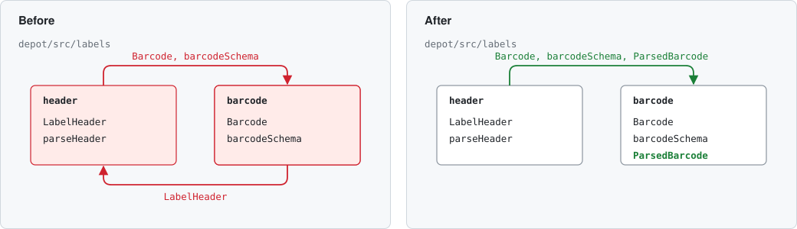
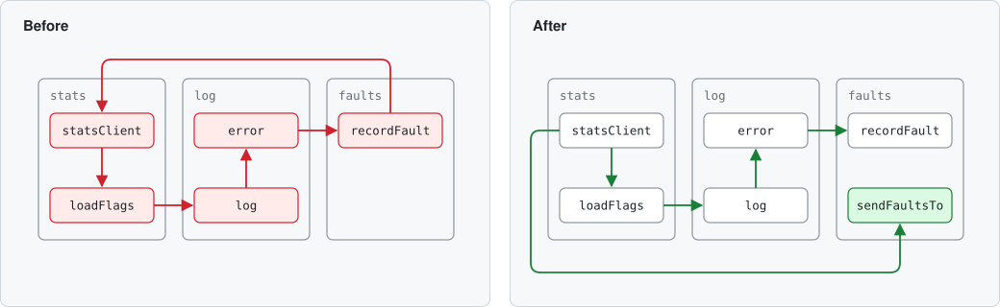
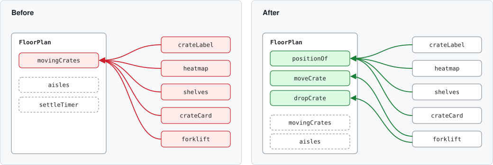
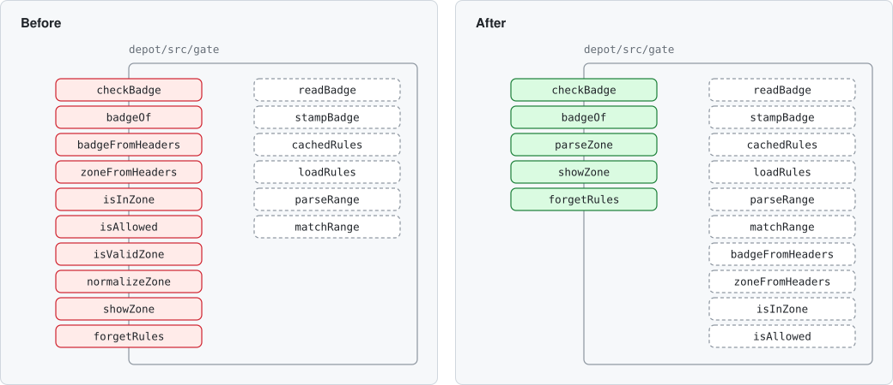

# deslop-please-ts

An opinionated linter to remove sloppy TypeScript code. It follows [*A Philosophy of Software Design*](https://www.amazon.com/Philosophy-Software-Design-John-Ousterhout/dp/1732102201): **deep** modules, **narrow** interfaces.

It is a port of [`deslop-please`](https://github.com/deterministic-machines/deslop-please), which checks Rust workspaces. The lints, the limits and the report are the same. Only the reader is new: it reads a TypeScript workspace through the TypeScript 7 compiler.

## Install

It needs Node 22.18 or newer. It brings its own TypeScript compiler, so the project it checks needs none.

```bash
npm install --save-dev deslop-please-ts
```

## Use

Run it in a directory of a TypeScript project.

```
> npx deslop-please-ts

error[field-leak]: `RunQueue.head` is known outside `RunQueue`: 1 place in 1 module
  --> src/sched/policy.ts:16:1
  = note: src/sched/policy.ts:16:1: `runqueue/src/sched/policy:next`
    runqueue/src/queue/ring:RunQueue
      head ◀━━━ 1  runqueue/src/sched/policy
      also known outside: items
      kept: limit

error[field-leak]: `RunQueue.items` is known outside `RunQueue`: 4 places in 2 modules
  --> src/sched/policy.ts:7:1
  = note: src/sched/policy.ts:7:1: `runqueue/src/sched/policy:admit`
  = note: src/sched/policy.ts:12:1: `runqueue/src/sched/policy:next`
  = note: src/sched/report.ts:4:1: `runqueue/src/sched/report:backlog`
  = note: src/sched/report.ts:8:1: `runqueue/src/sched/report:drained`
    runqueue/src/queue/ring:RunQueue
      items ◀━┳━ 2  runqueue/src/sched/policy
              ┗━ 2  runqueue/src/sched/report
      also known outside: head
      kept: limit

deslop-please-ts: 2 errors, well done!
```

Check one package or one module:

```bash
npx deslop-please-ts runqueue/src/sched
```

The exit code is 0 when the report is empty, 1 when it has errors, and 2 when the tool cannot run.

### Mute what is there today

```bash
npx deslop-please-ts --update-allow .deslop-please-ts.allow
npx deslop-please-ts --allow .deslop-please-ts.allow
```

The allow file lists one `<lint> <key>` per line. New errors still fail. An error that is fixed never fails, and the tool says when the file can be tightened.

### Add to your `AGENTS.md`

```markdown
- Run `npx deslop-please-ts` to check for sloppy code structure.
- Errors flagged by `deslop-please-ts` must be fixed from first principles. Do not make mechanical moves to hide them.
    - `module-cycle` and `tangle`: what is the intended layer of abstraction? Which module should be at which layer?
    - `field-leak` and `shallow-module`: why do these fields and functions exist at all? What are the patterns of use? Can they be hidden behind a narrow interface? Fix them as a whole, not one leak at a time.
    - Draw a diagram of the structure before and the proposed structure after.
```

## The lints

They are one idea: deep modules, narrow interfaces. A deep module hides work behind a small interface, so a reader only has to learn the interface.

| Lint | What it reports |
|---|---|
| `module-cycle` | Sibling modules that use each other in a circle, so there is no order to read them in. |
| `tangle` | Types, functions and constants that know each other in a circle, written in more than one module, or more than seven of them. |
| `field-leak` | Code that works on a field of a class it is not part of: it writes the field, reaches into it, or holds the object the field keeps. Reading a plain value is no leak. |
| `shallow-module` | A package or directory that shows more than seven functions to the outside, at least as many as it hides. |
| `wide-directory` | A directory with more than 15 TypeScript files and directories. |
| `long-file` | A file with more than 2,000 lines. |

## Examples

Each picture shows one report and one way to correct it. The red parts are the problem. The green parts are new.

### module-cycle

Before, `header` uses `barcode` and `barcode` uses `header`, so you cannot read one of them without the other. `barcode` needs only one type of `header`. After, that type is in `barcode` as `ParsedBarcode`, and only `header` uses `barcode`.



### tangle

Before, five functions in three modules know each other in a circle: `statsClient` calls `loadFlags`, `loadFlags` writes to the log, an error in the log calls `recordFault` and `recordFault` calls `statsClient`. After, `faults` has the function `sendFaultsTo`. `statsClient` calls it one time at the start, and `recordFault` does not know `statsClient`.



### field-leak

Before, five modules read and change the field `movingCrates` of `FloorPlan`. A change to this field can break all five. After, the field is private. The five modules call three methods of `FloorPlan`, and only `FloorPlan` works on its field.



### shallow-module

Before, `gate` shows 10 of its 16 functions, so a user of `gate` must learn most of its parts. After, `gate` shows 5 functions and hides the others behind them. One function `parseZone` replaces `isValidZone` and `normalizeZone`.



## How it reads TypeScript

| In the report | In the project |
|---|---|
| workspace | The nearest directory upward with a `pnpm-workspace.yaml` or a `package.json` with `workspaces`, or else the nearest `package.json`. |
| package | The workspace root and each workspace member, named by its `package.json`. |
| module | A directory or a file. `index.ts` is the own code of its directory. `queue.ts` beside `queue/` is the same module. |
| checked files | The `.ts`, `.tsx`, `.mts` and `.cts` files of each package's `tsconfig.json` and of the projects it references. Declaration files, `node_modules`, dot directories and files that git ignores are left out. |
| test code | Files named `.test.`, `.spec.` or `.stories.`, and the directories `test`, `tests`, `__tests__` and `__mocks__`. Test code never counts as a user of other code. |
| type | A class, interface, type alias or enum, with its fields, methods and members. |
| function | A function, a method, a getter or setter, or a variable that holds a function. |
| name | A module is written as a path, `runqueue/src/queue/ring`. A thing is written after a colon, `runqueue/src/queue/ring:RunQueue`. A member is written after a dot, `RunQueue.items`. |

A getter that only hands out a field, and a function that only passes its call on, hide nothing. The tool looks through them and reports the code that calls them.

## Develop

| Command | What it runs |
|---|---|
| `npm run check` | The type check. |
| `npm test` | The unit tests and the end-to-end tests on the projects in `tests/fixtures`. |
| `npm run self` | The tool on its own code. |

## License

MIT. Copyright of the original `deslop-please` belongs to Deterministic Machines, Inc.
